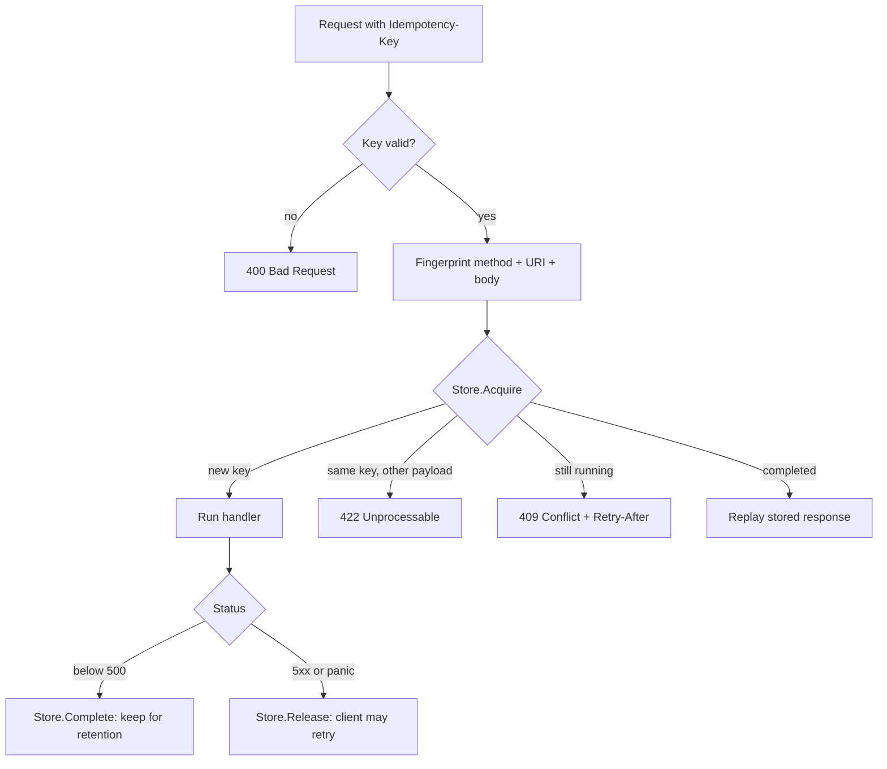

<div align="center">

# Aion

**Reliability primitives for Go backends that move money and messages.**

<sub>Aion is the Greek god of unending time, standing inside the ring that holds the turning of the ages.<br>
Every package here is about time: how long a key is held, how long a result is kept, when it is safe to try again.</sub>

[Quick start](#quick-start) · [How it works](#how-it-works) · [Packages](#packages) · [Design](#design) · [Docs](https://pkg.go.dev/github.com/b1ll1eee/aion-kit)

</div>

---

A customer taps **Pay**. The network stalls, the app retries, the
customer taps again. Three requests reach your server. Without a guard,
that is three charges and one very angry support ticket.

```go
store := idempotency.NewMemoryStore()
pay := idempotency.Middleware(store)(payHandler)

mux.Handle("POST /payments", pay)
```

Now every retry with the same `Idempotency-Key` gets the first response
back, byte for byte, and the charge runs exactly once.

```text
POST /payments  Idempotency-Key: order-42   → 201 charge #1
POST /payments  Idempotency-Key: order-42   → 201 charge #1  (replayed)
POST /payments  Idempotency-Key: order-42   → 201 charge #1  (replayed)
```

This kit grew out of production payment and SMS systems, where a
duplicate is a refund and a lost message is a missed OTP.

## Quick start

```sh
go get github.com/b1ll1eee/aion-kit
```

```go
import "github.com/b1ll1eee/aion-kit/idempotency"

h := idempotency.Middleware(store,
	idempotency.WithRequired(),           // 400 without a key
	idempotency.WithRetention(24*time.Hour),
	idempotency.WithLockTimeout(30*time.Second),
)(payHandler)
```

Not on HTTP? The same protocol protects a queue consumer or an SMS
sender through `Guard`:

```go
att, err := guard.Begin(ctx, key, fingerprint)
if err != nil {
	return err // ErrInFlight, ErrMismatch, or store down
}
if msgID, done := att.Replay(); done {
	return nil // already sent; msgID is the stored result
}
msgID, err := gateway.Send(ctx, sms)
if err != nil {
	guard.Abort(ctx, att) // let the next retry try again
	return err
}
return guard.Complete(ctx, att, msgID)
```

## How it works



| What the client sees | When |
|---|---|
| The handler's response | First request with a new key |
| The same response, plus `Idempotent-Replayed: true` | Retry after it finished |
| `409 Conflict` with `Retry-After` | Retry while the first is still running |
| `422 Unprocessable Entity` | Same key, different body |
| `400 Bad Request` | Malformed key, or missing when required |
| `413 Payload Too Large` | Body over the fingerprint limit (1 MiB) |
| `503 Service Unavailable` | Store unreachable. It fails closed: no guard, no charge |

## Packages

| Package | What it guards | Status |
|---|---|---|
| [`idempotency`](idempotency) | Double charges from retries and double taps | Ready |
| `redisstore` | Shared idempotency store for many replicas | Next |
| `outbox` | Postgres commit + Kafka publish that never drift apart | Planned |
| `ratelimit` | Redis-backed limits for SMS gateways and partner APIs | Planned |

The root module depends on the standard library only. Backends such as
Redis, Postgres and Kafka live in their own modules, so importing
`idempotency` never pulls a Kafka client into your `go.sum`.

## Design

<details>
<summary><b>Ports and adapters</b>: the core never imports HTTP or a database</summary>

<br>

```text
 net/http ─▶ Middleware ─▶ Guard ─▶ Store (port) ◀─ MemoryStore
 (adapter)                 (core)                ◀─ redisstore
                                                 ◀─ your store
```

- `Key`, `Fingerprint`, `Lease` and `Record` are value objects with
  their rules built in. A `Key` cannot exist unless it is valid.
- `Record` changes state only through `Complete`, which returns a new
  value, so read-modify-write stores can share the same rules.
- `Guard` runs begin / complete / abort and knows nothing about HTTP.
- `Middleware` is a thin adapter that maps domain errors to statuses.

</details>

<details>
<summary><b>Lease fencing</b>: a slow request cannot overwrite a newer one</summary>

<br>

Each `Acquire` hands out a random lease. `Complete` and `Release` only
work for the lease that currently holds the key. If a handler outlives
its lock timeout and a retry takes over, the slow handler's late write
is rejected with `ErrLeaseLost` instead of clobbering the newer result.

</details>

<details>
<summary><b>Contract tests</b>: write your own store and prove it</summary>

<br>

Every store, built in or yours, runs the same suite: atomic acquire
under 32 concurrent callers, lease fencing, TTL and retention expiry,
binary-safe results.

```go
func TestMyStore(t *testing.T) {
	idempotencytest.RunStoreSuite(t, idempotencytest.Harness{
		NewStore: func(t *testing.T) idempotency.Store {
			return mystore.New(testDB(t))
		},
	})
}
```

</details>

<details>
<summary><b>Performance</b>: zero cost when there is no key</summary>

<br>

Apple M-series, Go 1.27, `MemoryStore`. The keyed numbers include
building the request with `httptest.NewRequest`.

| Path | Time | Allocs |
|---|---|---|
| No key (pass-through) | 21 ns | 0 |
| Replay a stored response | 1.3 µs | 22 |
| First request (store result) | 5.8 µs | 23 |

Request and response buffers come from a `sync.Pool`. Stored responses
use a compact binary format, fuzz-tested against corrupt input.

</details>

<details>
<summary><b>All options</b></summary>

<br>

| Option | Default |
|---|---|
| `WithHeader(name)` | `Idempotency-Key` |
| `WithRequired()` | keyless requests pass through |
| `WithMethods(...)` | `POST`, `PATCH` |
| `WithRetention(d)` | 24h |
| `WithLockTimeout(d)` | 1m, must exceed your slowest handler |
| `WithMaxBodyBytes(n)` | 1 MiB |
| `WithFingerprint(f)` | method + request URI + body |
| `WithErrorHandler(h)` | plain text with `StatusCode(err)` |
| `WithReportError(f)` | `slog` error for results that failed to save |

</details>

## Contributing

```sh
go test -race ./...                               # all tests
go test -run='^$' -bench=. -benchmem ./idempotency  # benchmarks
go test -run='^$' -fuzz=FuzzDecodeResponse ./idempotency
```

Issues and pull requests are welcome. MIT licensed.
